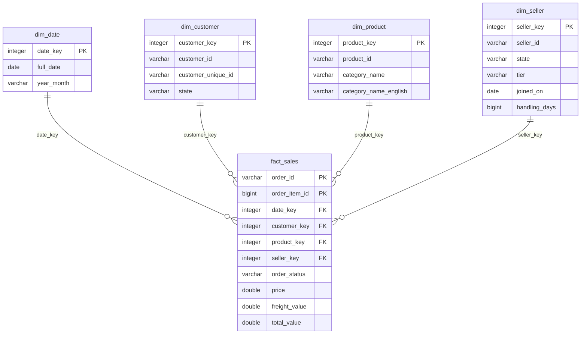

# NorthMart — Data Engineering 2026/27

Plataforma de dados da NorthMart construída em três etapas (PA1, PA2, PA3) para a unidade curricular de Data Engineering do IPB.

## Setup

Requisitos: Python 3.12+ (testado com 3.14).

```bash
python -m venv .venv
# Windows
.venv\Scripts\activate
# Linux / macOS / WSL
source .venv/bin/activate

pip install -r requirements.txt
```

### Dados de origem

Os arquivos de origem não são versionados. Antes de rodar qualquer script, coloque em `data/source/`:

1. Os 9 CSVs do [Brazilian E-Commerce Public Dataset by Olist](https://www.kaggle.com/datasets/olistbr/brazilian-ecommerce) (Kaggle), com os nomes originais.
2. O arquivo `northmart_seller_profiles.json` (página da disciplina no virtual.ipb.pt).

Contagem esperada de linhas:

| Arquivo | Linhas |
|---|---:|
| olist_customers_dataset.csv | 99 441 |
| olist_geolocation_dataset.csv | 1 000 163 |
| olist_order_items_dataset.csv | 112 650 |
| olist_order_payments_dataset.csv | 103 886 |
| olist_order_reviews_dataset.csv | 99 224 |
| olist_orders_dataset.csv | 99 441 |
| olist_products_dataset.csv | 32 951 |
| olist_sellers_dataset.csv | 3 095 |
| product_category_name_translation.csv | 71 |
| northmart_seller_profiles.json | 3 095 registros |

## Estrutura do repositório

```
├── README.md
├── requirements.txt
├── architecture/   # diagramas: star schema (PA1), pipeline (PA2)
├── data/
│   ├── source/     # CSVs da Olist e JSON de sellers (não versionado)
│   ├── raw/        # respostas da API por data (PA2, não versionado)
│   ├── staging/    # arquivos intermediários
│   └── curated/    # exports em Parquet e saídas finais
├── sql/            # profiling.sql, build_model.sql, queries de benchmark
├── src/            # código Python
├── tests/          # verificações fora do dbt
└── evidence/       # tabela de benchmark, screenshots, contagens
```

---

## PA1 — Dos arquivos brutos ao star schema

### Como reproduzir

Todos os comandos são executados a partir da raiz do repositório, com o ambiente virtual ativo. O banco DuckDB é criado em `data/northmart.duckdb` (não versionado).

**1. Carregar a camada raw**

```bash
python src/run_sql.py sql/load_raw.sql
```

Cria uma tabela `raw_*` para cada arquivo de `data/source/`, sem nenhuma transformação, e no final mostra a contagem de linhas de cada tabela (deve bater com a tabela da seção "Dados de origem").

| Tabela | Origem |
|---|---|
| raw_orders | olist_orders_dataset.csv |
| raw_order_items | olist_order_items_dataset.csv |
| raw_customers | olist_customers_dataset.csv |
| raw_products | olist_products_dataset.csv |
| raw_sellers | olist_sellers_dataset.csv |
| raw_payments | olist_order_payments_dataset.csv |
| raw_reviews | olist_order_reviews_dataset.csv |
| raw_geolocation | olist_geolocation_dataset.csv |
| raw_category_translation | product_category_name_translation.csv |
| raw_seller_profiles | northmart_seller_profiles.json (campos aninhados mantidos como STRUCT) |

**2. Profiling da camada raw**

```bash
python src/run_sql.py sql/profiling.sql > evidence/profiling_output.txt
```

Roda todas as verificações de qualidade sobre as tabelas raw e guarda a saída (queries e resultados) em `evidence/profiling_output.txt`. Os achados estão na seção "Tarefa 1".

**3. Construir o star schema**

```bash
python src/run_sql.py sql/load_raw.sql sql/build_model.sql > evidence/build_model_output.txt
```

Recarrega a camada raw a partir dos arquivos de origem e, em seguida, constrói o modelo: achata e deduplica os perfis do JSON (`stg_seller_profiles`), cria `dim_date`, `dim_customer`, `dim_product`, `dim_seller` e `fact_sales`, e termina com 15 checagens referenciais e de qualidade. A saída fica em `evidence/build_model_output.txt`. Todas as checagens devem mostrar `OK`.

**4. Exportar a fato para CSV e Parquet**

```bash
python src/run_sql.py sql/export_parquet.sql
```

Gera em `data/curated/` a mesma fato em três formatos: `fact_sales.csv`, `fact_sales.parquet` e `fact_sales_partitioned/` (uma pasta por `year_month`). No final, confere que os três têm 112 650 linhas e a mesma soma de `price`. O CSV não é versionado (é só a base de comparação e é recriado por este passo).

**5. Rodar o benchmark**

```bash
python src/benchmark.py > evidence/benchmark_output.txt
```

Mede o tamanho de cada formato e o tempo das três queries de `sql/benchmark_queries.sql` em cada um, confere se as respostas são iguais nos três formatos e grava os números em `evidence/benchmark_results.csv`.

### Tarefa 1 — Achados do profiling

Script: [`sql/profiling.sql`](sql/profiling.sql) · Saída completa: [`evidence/profiling_output.txt`](evidence/profiling_output.txt)

O profiling mediu, em todas as 10 tabelas raw: quantidade de linhas, unicidade das chaves, duplicados, porcentagem de nulos, registros órfãos entre tabelas e regras de negócio (ordem das datas, valores impossíveis, textos sem padrão).

#### Resumo por tabela: linhas, chaves, duplicados e nulos

| Tabela | Linhas | Chave | Valores distintos da chave | Duplicados na chave | Colunas com nulos (% de nulos) |
|---|---:|---|---:|---:|---|
| raw_orders | 99 441 | `order_id` | 99 441 | 0 | `order_approved_at` 0,16%, `order_delivered_carrier_date` 1,79%, `order_delivered_customer_date` 2,98% |
| raw_order_items | 112 650 | `order_id + order_item_id` | 112 650 | 0 | nenhuma |
| raw_customers | 99 441 | `customer_id` | 99 441 | 0 | nenhuma |
| raw_customers | 99 441 | `customer_unique_id` (pessoa) | 96 096 | 3 345 (mesma pessoa em pedidos diferentes) | — |
| raw_products | 32 951 | `product_id` | 32 951 | 0 | `product_category_name`, `product_name_lenght`, `product_description_lenght`, `product_photos_qty` 1,85%; peso e dimensões 0,01% |
| raw_sellers | 3 095 | `seller_id` | 3 095 | 0 | nenhuma |
| raw_payments | 103 886 | `order_id + payment_sequential` | 103 886 | 0 | nenhuma |
| raw_reviews | 99 224 | `review_id` | 98 410 | 814 | `review_comment_title` 88,34%, `review_comment_message` 58,70% |
| raw_geolocation | 1 000 163 | `geolocation_zip_code_prefix` | 19 015 | 981 148 (não é chave; 261 831 linhas são cópias exatas) | nenhuma |
| raw_category_translation | 71 | `product_category_name` | 71 | 0 | nenhuma |
| raw_seller_profiles (JSON) | 3 095 | `seller_id` | 3 070 | 25 | `shipping`, `shipping.carriers`, `shipping.handling_days` 0,97% (30 perfis) |

#### Principais achados

| # | Fonte | Achado | Impacto e tratamento no modelo |
|---|---|---|---|
| 1 | JSON | **25 `seller_id` repetidos**: 3 095 registros para 3 070 sellers. Cada um tem duas versões; a mais antiga é sempre de 2017-06-15 09:00, e em 7 casos o `tier` muda entre as versões (ex.: bronze → silver). | Juntar direto com a fato duplicaria as vendas desses sellers. Fica só a versão com o `updated_at` mais recente. |
| 2 | JSON | **`tier` escrito de 9 formas**: além de `bronze`, `silver` e `gold`, aparecem `Bronze ` (com espaço, 21), `BRONZE` (19), `SILVER` (7), `Silver ` (6), `Gold ` (5) e `GOLD` (2). **30 perfis não têm o bloco `shipping`**, logo não têm `handling_days`. | Agrupar por tier daria 9 grupos em vez de 3. O tier passa por `lower(trim(...))`. O `handling_days` ausente fica nulo (desconhecido), não 0. |
| 3 | JSON | **Cobertura incompleta nos dois sentidos**: 15 perfis não pertencem a nenhum seller da Olist e são dados de teste (e-mail `new_N@example.com`, mesmo telefone `+55 11 90000-0000`, mesmo `updated_at`). E 40 sellers da Olist não têm perfil; eles vendem 769 itens, R$ 78 585,05. | Os 15 perfis de teste são descartados (a `dim_seller` parte de `raw_sellers`). Os 40 sellers sem perfil continuam no modelo com tier `unknown`, para não perder as vendas deles. |
| 4 | JSON | **141 perfis com `joined_on` depois do `updated_at`**: o perfil teria sido atualizado antes de o seller existir. Já o `joined_on` é coerente com as vendas: nenhum seller vendeu antes da data de entrada. | O `joined_on` é usado como data de entrada. O `updated_at` serve só para escolher a versão mais recente do perfil. |
| 5 | customers | **`customer_id` não identifica a pessoa**: são 99 441 `customer_id` para 96 096 pessoas (`customer_unique_id`). O `customer_id` muda a cada pedido, e 3 345 registros são da mesma pessoa voltando a comprar. | Contar clientes por `customer_id` infla o número em 3,5%. A `dim_customer` guarda o `customer_unique_id` como atributo e a contagem de clientes usa ele. |
| 6 | products | **610 produtos sem categoria** (1,85%), que também não têm nome, descrição nem fotos. Eles somam 1 603 itens vendidos e R$ 179 535,28. Além disso, 2 categorias não têm tradução (`pc_gamer` e `portateis_cozinha_e_preparadores_de_alimentos`), com 24 itens. | Um JOIN simples descartaria R$ 185 mil de vendas no top 5 de categorias. Produto sem categoria recebe "sem_categoria" e categoria sem tradução usa o nome em português. |
| 7 | orders | **775 pedidos sem nenhum item** (603 `unavailable`, 164 `canceled`, entre outros). O mês 2016-11 não tem nenhum pedido, e as pontas do período estão quase vazias: 2016-09 (4), 2016-12 (1), 2018-09 (16) e 2018-10 (4). | Pedidos sem itens não entram numa fato com grão de item. A `dim_date` é um calendário contínuo, para o mês vazio aparecer como zero e não sumir. O benchmark usa um mês completo (2017-11). |
| 8 | payments | **Pagamento não bate com os itens em 380 pedidos**: em 232 deles se pagou mais de R$ 1 acima do preço + frete (juros do parcelamento). Há também 1 pedido sem pagamento e 3 pagamentos `not_defined` com valor 0. | Pagamento é registrado por pedido, não por item. Por isso fica fora da fato, e a receita é medida pelo `price` dos itens. |
| 9 | geolocation | **26% das linhas são duplicadas exatas** (261 831 de 1 000 163), com até 1 146 linhas para o mesmo CEP. Há 42 coordenadas fora do Brasil, 8 CEPs em dois estados e a mesma cidade com e sem acento (`são paulo` 24 918 vezes, `sao paulo` 135 800). | A tabela não é usada no star schema: cidade e estado já vêm de customers e sellers. |

#### Catálogo completo de inconsistências

Todos os números abaixo vêm de `evidence/profiling_output.txt`.

| Fonte | Verificação | Resultado | Tratamento |
|---|---|---|---|
| orders | `order_id` único | 0 duplicados | — |
| orders | Pedidos sem cliente | 0 | — |
| orders | Nulos em `order_approved_at` / `order_delivered_carrier_date` / `order_delivered_customer_date` | 0,16% / 1,79% / 2,98% | Datas não viram medida no PA1; a fato usa só a data da compra (0% nulo). |
| orders | Entregue à transportadora antes da compra | 166 | Valores mantidos como vieram; não usados no modelo. |
| orders | Entregue à transportadora antes da aprovação | 1 359 | Idem. |
| orders | Entregue ao cliente antes da transportadora | 23 | Idem. |
| orders | Status `delivered` sem data de entrega / sem aprovação | 8 / 14 | Idem. |
| orders | Status `canceled` com data de entrega | 6 | Idem. |
| orders | Itens de pedidos `canceled` e `unavailable` | 542 itens (R$ 95 235,27) e 7 itens (R$ 2 007,69) | Ficam na fato com o `order_status`; as queries de receita excluem esses dois status. |
| orders | Dias sem nenhum pedido entre a primeira e a última compra | 140 | `dim_date` contínua. |
| order_items | Chave `order_id + order_item_id` | 0 duplicados | — |
| order_items | Itens órfãos (sem pedido, produto ou seller) | 0 | Checagem repetida no build do modelo. |
| order_items | Preço ≤ 0 / frete negativo | 0 / 0 | — |
| order_items | Frete zero / frete maior que o preço | 383 / 4 124 | Valores plausíveis (frete grátis, produtos baratos); mantidos. |
| order_items | Mesmo produto em várias linhas do mesmo pedido | 7 088 combinações | Não existe coluna de quantidade: cada linha é uma unidade, e "itens vendidos" = número de linhas. |
| order_items | Pedidos com mais de um seller | 1 278 | O seller pertence ao item, não ao pedido; reforça o grão de item. |
| order_items | Prazo de envio > 60 dias após a compra | 12 (até 2020-04-09) | `shipping_limit_date` não entra no modelo. |
| customers | Pessoas com mais de um CEP | 250 | O endereço fica ligado ao `customer_id` (endereço daquele pedido). |
| customers | CEPs com mais de um nome de cidade | 39 (ex.: `embu` / `embu das artes`, `paraty` / `parati`) | Análises geográficas por estado (27 UFs válidas, 0 nulos). |
| customers | CEP fora da geolocalização | 278 | Geolocalização não usada. |
| products | Sem peso ou dimensões / peso zero | 2 / 4 | Atributos não usados nas análises do PA1. |
| products | Colunas com erro de grafia (`product_name_lenght`, `product_description_lenght`) | 2 colunas | Renomeadas para `length` no modelo. |
| products | Categorias quase repetidas (`casa_conforto` e `casa_conforto_2`, `eletrodomesticos` e `eletrodomesticos_2`) | 2 pares | Mantidas como vieram (não há como saber se são a mesma). |
| sellers | Cidade fora do padrão (barra, hífen, vírgula, espaço duplo, acento, número, e-mail) | 27 sellers, ex.: `sao paulo - sp`, `sp / sp`, `sbc/sp`, `04482255`, `vendas@creditparts.com.br` | Análises geográficas por estado (0 nulos). |
| sellers | "sao paulo" escrito de formas diferentes | 7 variações além da correta (`sao paulop`, `sao  paulo`, `são paulo`...) | Idem. |
| sellers | CEP fora da geolocalização | 7 | Geolocalização não usada. |
| reviews | `review_id` usado em mais de um pedido | 789 ids (814 linhas extras) | Avaliações ficam fora da fato. |
| reviews | Pedidos com mais de uma avaliação / sem avaliação | 547 / 768 | Idem. |
| reviews | Avaliação criada antes da compra | 64 | Idem. |
| reviews | Título / comentário nulos | 88,34% / 58,70% | Texto livre não é carregado no modelo. |
| payments | Valor zero / 0 parcelas | 9 / 2 | Pagamentos fora da fato. |
| JSON | E-mail e telefone dos sellers | dados pessoais em 100% dos perfis | Não entram no modelo (não são necessários para análise de vendas). |

#### Prevenção: verificações automáticas no build

Para que esses problemas não voltem sem ninguém perceber, o `build_model.sql` termina com verificações que precisam dar o resultado esperado:

- A fato tem 112 650 linhas e a mesma soma de `price` da `raw_order_items` (nenhum item perdido ou duplicado nos JOINs).
- Nenhuma linha da fato sem dimensão correspondente (0 órfãos em cada chave).
- A `dim_seller` tem exatamente uma linha por `seller_id` (3 095).
- O `tier` só tem os valores `bronze`, `silver`, `gold` ou `unknown`.
- O `handling_days` é nulo ou maior que zero.
- As surrogate keys de cada dimensão são únicas.

No PA2, essas mesmas regras viram testes do dbt.

### Tarefa 2 — Star schema

Diagrama completo, dicionário de colunas e todas as decisões: [`architecture/star_schema.md`](architecture/star_schema.md)



**Grão:** uma linha por item de pedido (`order_id + order_item_id`), ou seja, uma unidade de um produto vendida por um seller num pedido. São 112 650 linhas. Esse grão é necessário porque preço, frete, produto e seller pertencem ao item: 1 278 pedidos têm itens de mais de um seller, e a fonte não tem coluna de quantidade (3 unidades do mesmo produto viram 3 linhas).

**Medidas:** `price` (preço do item), `freight_value` (frete do item) e `total_value` (`price + freight_value`), todas aditivas. A quantidade de itens vendidos é `count(*)`. A **receita** é `sum(price)` excluindo os pedidos `canceled` e `unavailable`, que continuam na fato com o `order_status` mas não geraram venda.

**Dimensões:** `dim_date` (calendário contínuo de 791 dias, 2016-09-01 a 2018-10-31), `dim_customer` (99 441 linhas), `dim_product` (32 951) e `dim_seller` (3 095, com `tier`, `joined_on` e `handling_days` vindos do JSON).

**Decisão de modelagem não óbvia — a `dim_customer` tem uma linha por `customer_id`, não por pessoa.** Na Olist, o `customer_id` é criado a cada pedido: são 99 441 ids para 96 096 pessoas (`customer_unique_id`). Escolhemos o `customer_id` como grão da dimensão porque o pedido já traz esse id (o JOIN com a fato é direto) e porque cada linha guarda o endereço daquela compra: 250 pessoas mudaram de CEP entre pedidos, e com uma linha por pessoa seria preciso escolher um endereço e reescrever o histórico. O `customer_unique_id` fica como atributo da dimensão, e é ele que conta clientes: `count(DISTINCT customer_unique_id)`. Contar por `customer_key` infla o número de clientes em 3,5%.

### Tarefa 3 — Implementação do modelo

Script: [`sql/build_model.sql`](sql/build_model.sql) · Saída: [`evidence/build_model_output.txt`](evidence/build_model_output.txt)

O modelo é construído só com SQL, a partir das tabelas raw, nesta ordem:

1. **`stg_seller_profiles`**: achata os campos aninhados do JSON (`profile.tier`, `profile.joined_on`, `shipping.handling_days`), normaliza o tier com `lower(trim(...))` e mantém só a versão mais recente de cada seller (`row_number()` por `seller_id`, ordenado por `updated_at` decrescente). Resultado: 3 070 perfis, um por seller.
2. **Dimensões**: cada uma ganha uma surrogate key inteira, gerada com `row_number()` na ordem da chave natural, para que a mesma linha receba a mesma chave a cada execução. A `dim_seller` parte dos 3 095 sellers da Olist e recebe `tier`, `joined_on` e `handling_days` do perfil, com `tier = 'unknown'` para os 40 sellers sem perfil.
3. **`fact_sales`**: uma linha por item de `raw_order_items`, com a data e o status vindos de `raw_orders` e as surrogate keys das dimensões. Todos os JOINs são `LEFT JOIN`, para que um item sem correspondência não desapareça em silêncio: ele fica com a chave nula, e as checagens acusam.
4. **Checagens**: 15 verificações que comparam o valor encontrado com o esperado.

| Verificação | Encontrado | Esperado | Resultado |
|---|---:|---:|---|
| Fato: linhas iguais às de `raw_order_items` | 112 650 | 112 650 | OK |
| Fato: `order_id + order_item_id` sem duplicados | 0 | 0 | OK |
| Fato: soma de `price` (em centavos) igual à da raw | 1 359 164 370 | 1 359 164 370 | OK |
| Órfãos: fato sem `dim_date` / `dim_customer` / `dim_product` / `dim_seller` | 0 / 0 / 0 / 0 | 0 | OK |
| `dim_date`: `date_key` sem duplicados | 0 | 0 | OK |
| `dim_customer`, `dim_product`, `dim_seller`: uma linha por chave natural da raw | 99 441 / 32 951 / 3 095 | 99 441 / 32 951 / 3 095 | OK |
| `dim_seller`: nenhum `seller_id` repetido | 0 | 0 | OK |
| `stg_seller_profiles`: um perfil por seller | 0 | 0 | OK |
| `dim_seller`: tier fora de `bronze`/`silver`/`gold`/`unknown` | 0 | 0 | OK |
| `dim_seller`: `handling_days` ≤ 0 | 0 | 0 | OK |

As checagens também foram testadas no sentido contrário: numa cópia do banco, apagamos um seller, duplicamos um item da fato e gravamos um tier `'Gold '`. Seis checagens passaram a mostrar `FALHA` (linhas, duplicados, soma, órfãos de seller, linhas da `dim_seller` e tier fora do padrão).

Sellers por tier depois do tratamento: `bronze` 1 828, `silver` 919, `gold` 308 e `unknown` 40.

### Tarefa 4 — Benchmark

Scripts: [`sql/export_parquet.sql`](sql/export_parquet.sql), [`sql/benchmark_queries.sql`](sql/benchmark_queries.sql), [`src/benchmark.py`](src/benchmark.py) · Saída: [`evidence/benchmark_output.txt`](evidence/benchmark_output.txt), [`evidence/benchmark_results.csv`](evidence/benchmark_results.csv)

#### Método

- **Mesmos dados nos três formatos.** A `fact_sales` (112 650 linhas) foi exportada, com a coluna `year_month`, para CSV, Parquet num arquivo só e Parquet particionado por `year_month`. O DuckDB comprime o Parquet com snappy, que é o padrão.
- **Coluna de partição: `year_month`, o mês da compra.** As análises de vendas são quase sempre por período, e a query 2 filtra um único mês. São 24 partições: os meses 2016-11 e 2018-10 não têm itens vendidos.
- **Mesmas queries nos três formatos.** As queries leem a fato por uma view `fato`, que o `benchmark.py` recria apontando para cada formato. O texto das queries não muda; as dimensões vêm do banco DuckDB. Em todas, a receita exclui os pedidos `canceled` e `unavailable`.
- **Repetições.** Para cada formato e cada query, há 1 execução de aquecimento (descartada) e 10 execuções medidas. O valor reportado é a **mediana**, que não é puxada por uma execução fora da curva. Mínimo e máximo estão no CSV de resultados.
- **Medição repetida.** O script inteiro foi rodado duas vezes. As medianas variaram no máximo 22% entre as rodadas (nos tempos de poucos milissegundos, como a Q2 no particionado: 4,9 e 3,8 ms), e a ordem dos formatos foi a mesma nas duas.
- **Respostas conferidas.** As três queries deram exatamente o mesmo resultado nos três formatos.
- **Ambiente.** Windows 11, processador Intel com 20 núcleos lógicos, Python 3.14.7, DuckDB 2.0.0.
- **Limitação.** Os arquivos já estavam no cache do sistema operacional depois do aquecimento, então o teste mede principalmente o processamento, não a leitura do disco.

#### Resultados

| Formato | Tamanho (MB) | Q1: receita por mês (ms) | Q2: receita e itens de 2017-11 (ms) | Q3: top 5 categorias (ms) |
|---|---:|---:|---:|---:|
| CSV | 10,30 | 74,2 | 66,9 | 79,6 |
| Parquet | 5,47 | 6,9 | 2,4 | 13,6 |
| Parquet particionado | 5,54 | 18,1 | 4,9 | 17,7 |

Respostas das queries: em 2017-11 a receita foi de R$ 1 003 862,14, com 8 626 itens. As cinco categorias com maior receita foram `health_beauty` (R$ 1 255 695,13), `watches_gifts`, `bed_bath_table`, `sports_leisure` e `computers_accessories`. A receita por mês de todo o período está em `evidence/benchmark_output.txt`, incluindo 2016-11 com receita 0.

#### Análise

1. **O Parquet ocupa 53% do CSV.** O formato guarda os dados por coluna e comprimidos. O ganho não é maior por causa do `order_id`: ele sozinho ocupa 3,30 dos 5,47 MB (60%) do arquivo, porque é um código aleatório de 32 caracteres que quase não comprime.
2. **O Parquet é de 6 a 28 vezes mais rápido que o CSV.** A cada query, o CSV precisa ser lido inteiro como texto e convertido para números e datas. O Parquet já guarda os tipos e permite ler só as colunas que a query usa: a Q2, por exemplo, lê apenas `price`, `order_status` e `year_month`. O maior ganho é na Q2 (66,9 ms → 2,4 ms), que usa menos colunas.
3. **A partição não compensou neste volume de dados.** O Parquet particionado foi mais lento que o simples nas três queries, inclusive na Q2, que filtra pela coluna de partição. A partição funciona: o plano de execução (`EXPLAIN ANALYZE`) mostra `Scanning Files: 1/24`, ou seja, só a pasta de 2017-11 é lida. Mas listar e abrir 24 arquivos custa mais do que ler um único arquivo de 5,5 MB, que tem um só bloco (row group) de 112 650 linhas. As partições são pequenas demais (no máximo 8 665 linhas; algumas têm menos de 2 KB). Particionar compensa quando cada partição tem muito dado (centenas de MB ou mais) e o filtro evita ler a maior parte dele.
4. **O particionado é um pouco maior que o Parquet simples** (5,54 contra 5,47 MB), porque cada um dos 24 arquivos tem o seu próprio cabeçalho e metadados.

### Tarefa 5 — Data warehouse, data lake ou lakehouse?

Para a NorthMart, escolheríamos um Lakehouse. Como num Data Lake, os ficheiros CSV e JSON são preservados sem alterações na camada raw; como num Data Warehouse, os dados tratados ficam organizados num modelo dimensional, com verificações de qualidade, e guardados em Parquet, um formato aberto.

As nossas medições justificam a escolha. O Parquet ocupou 5,47 MB, contra 10,30 MB do CSV. A consulta de receita mensal, feita pelo DuckDB diretamente sobre o ficheiro, demorou 6,9 ms em Parquet, contra 74,2 ms em CSV: desempenho de Data Warehouse sem copiar os dados para um sistema separado. Um Data Lake sozinho não resolveria o problema dos analistas, que juntam os ficheiros de formas diferentes.

O particionamento ficaria para mais tarde: com este volume, o Parquet particionado foi mais lento (18,1 ms), porque abrir 24 ficheiros pequenos custa mais do que ler um só.

---

## PA2 — Pipeline ELT orquestrado e testado

_A preencher._

---

## PA3 — Proteção de dados e exploração de ferramenta

_A preencher._
