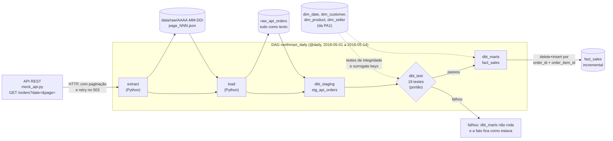

# Pipeline ELT diário — NorthMart (PA2)

Pipeline que, a cada dia, busca os pedidos na API, guarda as respostas sem alterações, transforma com dbt e só atualiza a `fact_sales` se os testes passarem. Roda no Airflow, na DAG [`airflow/dags/northmart_daily.py`](../airflow/dags/northmart_daily.py).

## Diagrama

Tudo fica num único arquivo DuckDB (`data/northmart_pa2.duckdb`), menos a camada raw de arquivos, que fica em `data/raw/`.

## As tarefas

| Tarefa | O que faz | Código | Entrada → saída |
|---|---|---|---|
| `extract` | Pede todas as páginas da data à API. Tenta de novo em 503, 5xx, timeout e falha de conexão. Grava as respostas byte a byte | [`src/extract_orders.py`](../src/extract_orders.py) | API → `data/raw/<data>/page_NNN.json` |
| `load` | Lê os JSON da data e grava uma linha por item, com todas as colunas como texto, mais `_run_date`, `_source_file` e `_loaded_at` | [`src/load_raw_api.py`](../src/load_raw_api.py) | `data/raw/<data>/` → `raw_api_orders` |
| `dbt_staging` | Tipa (`try_cast`) e limpa só o lote do dia, sem apagar nem deduplicar linhas | [`dbt/models/staging/stg_api_orders.sql`](../dbt/models/staging/stg_api_orders.sql) | `raw_api_orders` → view `stg_api_orders` |
| `dbt_test` | Unicidade, not null, integridade referencial, faixa, domínio, contrato da API e a regra de negócio | [`dbt/models/staging/schema.yml`](../dbt/models/staging/schema.yml) e [`dbt/tests/`](../dbt/tests/) | `stg_api_orders` → passa ou falha |
| `dbt_marts` | Busca as surrogate keys nas dimensões e grava o lote na fato | [`dbt/models/marts/fact_sales.sql`](../dbt/models/marts/fact_sales.sql) | `stg_api_orders` + dimensões → `fact_sales` |

## Decisões

- **O portão fica entre o staging e os marts.** Se um teste falha, o `dbt_marts` fica `upstream_failed` e um lote ruim nunca chega à fato.
- **Cada camada é idempotente.** O `extract` troca a pasta da data, o `load` apaga e reinsere a data, e o `dbt_marts` faz `delete+insert` pela chave do item. Rodar o mesmo dia de novo não duplica linhas.
- **Um dia de cada vez** (`max_active_runs=1` e `max_active_tasks=1`), porque o DuckDB aceita um único escritor.
- **A raw guarda tudo como texto.** Um valor malformado não derruba a carga; quem o acusa são os testes do dbt.
- **As dimensões não mudam.** A API não traz clientes, produtos nem sellers novos, então as dimensões da PA1 entram no dbt como *sources*.
