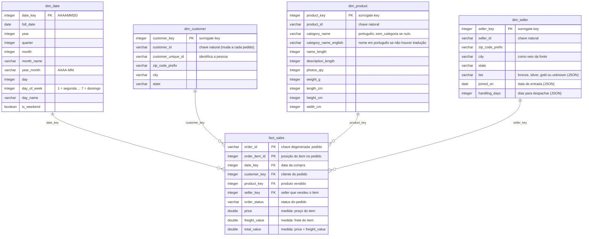

# Star schema de vendas — NorthMart (PA1)

Modelo dimensional para análise de vendas, construído a partir das tabelas raw pelo `sql/build_model.sql`.

## Diagrama

## Grão da fato

**Uma linha por item de pedido**, identificada por `order_id + order_item_id`. Cada linha é uma unidade de um produto, vendida por um seller, num pedido. A fato tem 112 650 linhas, uma para cada linha da `raw_order_items`.

Por que esse grão:

- Preço, frete, produto e seller existem no nível do item, não do pedido.
- 1 278 pedidos têm itens de mais de um seller. Com grão de pedido, não daria para ligar a venda ao seller.
- É o nível mais detalhado que a fonte oferece. Não existe coluna de quantidade: quando o cliente compra 3 unidades do mesmo produto, a fonte cria 3 linhas.

## Medidas

| Medida | Tipo | Definição | Como somar |
|---|---|---|---|
| `price` | aditiva | Preço do item | `sum(price)` |
| `freight_value` | aditiva | Frete do item | `sum(freight_value)` |
| `total_value` | aditiva | `price + freight_value` | `sum(total_value)` |
| itens vendidos | contagem | Cada linha é uma unidade | `count(*)` |

**Receita** = `sum(price)` dos itens cujo pedido não está `canceled` nem `unavailable`. Esses pedidos continuam na fato (com o `order_status`), mas ficam fora da receita, porque não geraram venda.

## Dimensões

| Dimensão | Grão | Linhas | Origem |
|---|---|---:|---|
| `dim_date` | um dia | 791 | Calendário contínuo de 2016-09-01 a 2018-10-31 (meses completos do período dos pedidos) |
| `dim_customer` | um `customer_id` | 99 441 | `raw_customers` |
| `dim_product` | um `product_id` | 32 951 | `raw_products` + `raw_category_translation` |
| `dim_seller` | um `seller_id` | 3 095 | `raw_sellers` + perfil mais recente de `raw_seller_profiles` |

### Chaves

- As **surrogate keys** (`customer_key`, `product_key`, `seller_key`) são inteiros sequenciais gerados no build. Os ids da Olist são textos de 32 caracteres; um inteiro ocupa menos espaço e deixa os JOINs mais rápidos.
- A chave natural (`customer_id`, `product_id`, `seller_id`) continua na dimensão, para rastrear de onde veio cada linha.
- A `date_key` é a data escrita como número `AAAAMMDD` (ex.: 20171124). É uma chave inteira e legível ao mesmo tempo.
- `order_id` e `order_item_id` ficam na fato como **dimensão degenerada**: identificam o pedido, mas não têm atributos próprios que justifiquem uma tabela.

## Decisões de modelagem

1. **`dim_customer` com uma linha por `customer_id`, e não por pessoa.** Na Olist, o `customer_id` é criado a cada pedido: 99 441 ids para 96 096 pessoas (`customer_unique_id`). Com uma linha por `customer_id`, o pedido se liga direto à dimensão e cada linha guarda o endereço daquela compra (250 pessoas mudaram de CEP entre pedidos). O `customer_unique_id` fica como atributo, e é ele que deve ser usado para contar clientes: `count(DISTINCT customer_unique_id)`. Contar por `customer_key` infla o número de clientes em 3,5%.
2. **Pagamentos e avaliações ficam fora da fato.** Os dois são registrados por pedido, não por item. Repetir o pagamento em cada item multiplicaria o valor nos pedidos com vários itens, e dividir entre os itens exigiria uma regra inventada. Além disso, em 380 pedidos o valor pago não bate com preço + frete.
3. **`dim_seller` parte da `raw_sellers` e recebe o perfil do JSON.** Do JSON entra só a versão mais recente de cada seller (maior `updated_at`), com o `tier` normalizado (`lower(trim(...))`). Os 40 sellers sem perfil ficam com `tier = 'unknown'` e `joined_on`/`handling_days` nulos. Os 15 perfis de teste, sem seller na Olist, não entram. E-mail e telefone também não entram: são dados pessoais e não servem para analisar vendas.
4. **Cidade do seller mantida como veio; análises geográficas por estado.** 27 sellers têm a cidade fora do padrão, e alguns casos não dá para corrigir automaticamente (um CEP e um e-mail no lugar da cidade). O estado está 100% preenchido e válido.
5. **Produto sem categoria não sai das análises.** Os 610 produtos sem categoria recebem `sem_categoria` (1 603 itens, R$ 179 535,28), e as 2 categorias sem tradução usam o nome em português. Sem isso, um JOIN simples descartaria esses itens.
6. **Calendário contínuo na `dim_date`.** O mês 2016-11 não tem nenhum pedido, e há 140 dias sem compras no período. O calendário tem todos os dias, para que períodos sem venda apareçam como zero em vez de sumir.
